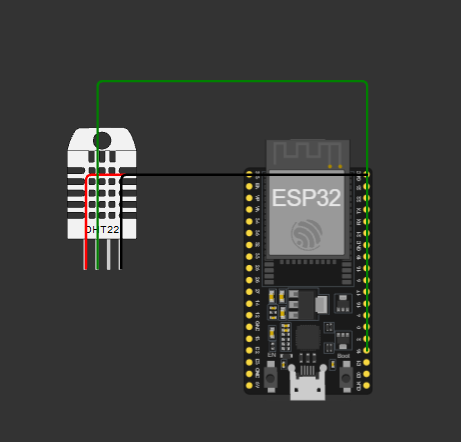

# 🌡️ Smart Environmental Monitoring System

An ESP32-based IoT project that monitors temperature and humidity using a DHT22 sensor and sends sensor readings to the ThingSpeak cloud platform for remote monitoring.

## 📌 Project Overview

The Smart Environmental Monitoring System measures environmental temperature and relative humidity. It checks the readings against predefined thresholds and displays the current environmental status through the Serial Monitor.

Sensor data is uploaded to ThingSpeak, where it can be monitored using cloud-based graphs and visualizations.

This project was developed and tested using the Wokwi online simulator.

## 🎯 Objectives

- Monitor temperature and humidity in real time.
- Connect an ESP32 to Wi-Fi.
- Upload sensor readings to the ThingSpeak cloud.
- Detect high-temperature and high-humidity conditions.
- Understand the fundamentals of IoT, sensor interfacing, and cloud integration.

## ✨ Features

- Temperature measurement in degrees Celsius.
- Relative humidity measurement in percentage.
- Automatic environmental status detection.
- High-temperature alert when temperature exceeds 30°C.
- High-humidity alert when humidity exceeds 70%.
- Wi-Fi connectivity using the Wokwi guest network.
- Cloud data logging through ThingSpeak.
- Error handling for sensor readings and HTTP requests.

## 🧰 Hardware and Software Requirements

### Hardware Components

| Component | Purpose |
|---|---|
| ESP32 Development Board | Main microcontroller |
| DHT22 Sensor | Measures temperature and humidity |

### Software and Platforms

- Wokwi — circuit simulation
- Arduino C++ — embedded programming
- ThingSpeak — IoT cloud data visualization
- GitHub — source code and project documentation

## 🔌 Circuit Connections

The project uses an ESP32 development board and a DHT22 sensor.

| DHT22 Pin | ESP32 Connection |
|---|---|
| VCC | 3V3 |
| DATA | GPIO 15 |
| GND | GND |

The circuit configuration is available in [`diagram.json`](diagram.json).

**Note:** The circuit is simulated in Wokwi. Physical hardware has not been claimed as tested.
### Circuit Diagram

## ⚙️ Working Principle

1. The ESP32 initializes the DHT22 sensor.
2. The ESP32 connects to the Wi-Fi network.
3. The sensor measures temperature and humidity.
4. The program checks whether the sensor readings are valid.
5. The readings are compared with predefined alert thresholds.
6. The environmental status and warning messages are displayed in the Serial Monitor.
7. Temperature and humidity readings are sent to ThingSpeak.
8. The process repeats every 20 seconds.

## 🚨 Alert Conditions

| Condition | Status |
|---|---|
| Temperature ≤ 30°C and humidity ≤ 70% | NORMAL |
| Temperature > 30°C | HIGH TEMPERATURE |
| Humidity > 70% | HIGH HUMIDITY |
| Both thresholds exceeded | Both warnings are displayed |

The system reports an alert when either threshold is exceeded.

## ☁️ ThingSpeak Integration

The project uploads sensor readings to ThingSpeak using its HTTP update endpoint.

| ThingSpeak Field | Data |
|---|---|
| Field 1 | Temperature (°C) |
| Field 2 | Relative Humidity (%) |

The program checks the HTTP response and the returned entry ID to determine whether an update was accepted.

ThingSpeak channel graphs can be used to visualize temperature and humidity trends over time.

## 📁 Project Files

| File | Description |
|---|---|
| `sketch.ino` | ESP32 application code |
| `diagram.json` | Wokwi circuit configuration |
| `libraries.txt` | Required Arduino libraries |
| `README.md` | Project documentation |

## ▶️ How to Run the Project

1. Open the project in Wokwi.
2. Open `sketch.ino` and review the code.
3. Ensure the required DHT sensor libraries are available.
4. Create a ThingSpeak channel with two fields: Temperature and Humidity.
5. Configure the ThingSpeak Write API Key in the code.
6. Start the Wokwi simulation.
7. Open the Serial Monitor to view sensor readings and status messages.
8. Open the ThingSpeak channel to view uploaded data.

**Security:** Never publish your real ThingSpeak Write API Key in a public repository. Use a placeholder in the public source code and configure your actual key privately when running the project.

## 🔗 Live Simulation

Explore the project in the Wokwi online simulator:

[Open Smart Environmental Monitoring System](https://wokwi.com/projects/478603464055254017)

## 🧪 Testing and Results

The simulation was tested with different temperature and humidity readings.

Observed behavior included:

- Normal status when both readings were within the configured thresholds.
- A high-temperature alert when temperature exceeded 30°C.
- A high-humidity alert when humidity exceeded 70%.
- Successful ThingSpeak updates when the HTTP response was `200` and a positive entry ID was returned.

## 🔮 Future Improvements

- Add email or mobile notifications for alerts.
- Store and analyze historical sensor data.
- Add additional environmental sensors.
- Build a custom web dashboard.
- Test the system using physical ESP32 hardware and a DHT22 sensor.

## 👩‍💻 Author

**Diksha Kadam**

B.Sc. Information Technology | 2026 Graduate

GitHub: [kadamdiksha60-hash](https://github.com/kadamdiksha60-hash)

---

*This project was created for learning and demonstrating IoT fundamentals, embedded programming, sensor interfacing, and cloud-based monitoring.*
